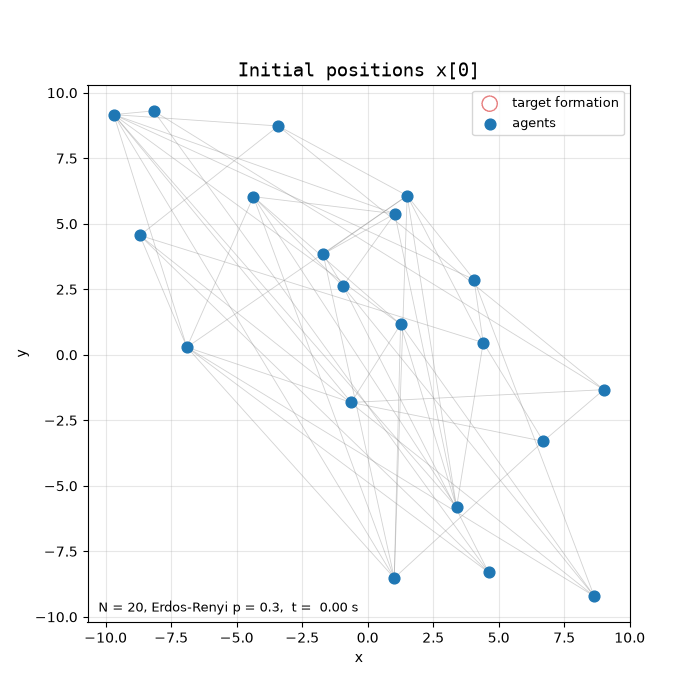

# Formation Control: Spelling "ROOPANSHA" with 20 Agents



Video: [name_formation.mp4](name_formation.mp4)

## Setup
- **Agents:** N = 20, random initial positions in R² (uniform in [-10, 10]²).
- **Graph:** Erdős–Rényi G(N, p) with p = 0.3, resampled until connected (λ₂(L) > 0).
- **Letters:** each letter is drawn as strokes. 20 evenly spread points are picked on the strokes (farthest-point sampling) and centred at the origin to give the desired formation p*.

## Control law
Displacement-based formation control:

ẋᵢ = K Σⱼ aᵢⱼ [ (xⱼ − xᵢ) − (pⱼ* − pᵢ*) ],  i.e.  ẋ = −K L (x − p*)

Because the graph is connected, x(t) − p* reaches consensus. The agents therefore converge to the letter shape p*, shifted by the centroid of x[0], which stays fixed under these dynamics.

The agents form R → O → O → P → A → N → S → H → A in sequence. Each letter starts from the previous formation. Before each letter, agents are matched to target points with the Hungarian algorithm, which minimises the total squared travel distance.

## Run
```
pip install numpy matplotlib scipy imageio-ffmpeg
python assignment_3_q1.py
```
This prints the convergence time of each letter and saves `name_formation.mp4` and `name_formation.gif`.
